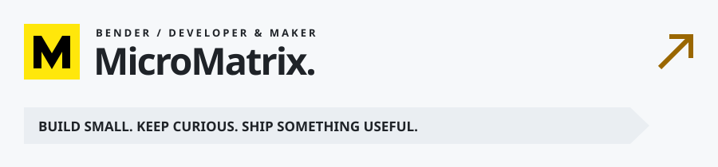

  

我是 **Bender**，喜欢把具体的问题，做成小而实用的软件。

关注前端产品、系统接口、自动化和网络工具。代码放在这里，过程和经验写在[博客](https://blog.micromatrix.org)。

### 常用工具

 

### GitHub 足迹

  
  

> 语言占比反映公开仓库中的代码分布。

<b>成就奖杯</b>

<b>3D 贡献地图</b>

---

**保持好奇，持续构建。** · [个人主页](https://micromatrix.org) · [博客](https://blog.micromatrix.org)

统计与贡献图片每天自动更新。主页源码的运行方式见 <a href="./docs/DEVELOPMENT.md">开发说明</a>；美化组件与配置见 <a href="./docs/PROFILE.md">Profile 说明</a>。
